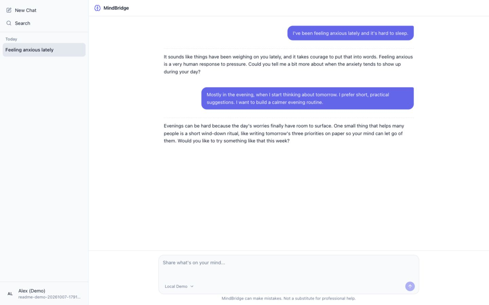
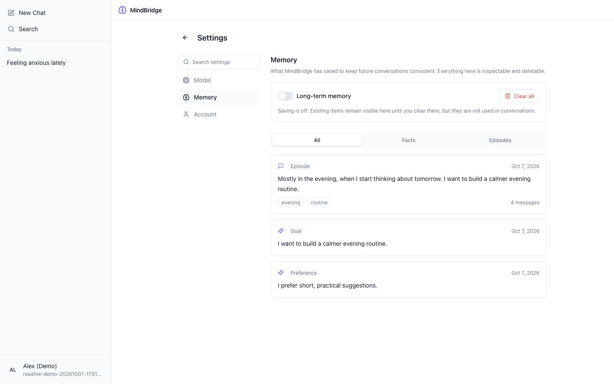
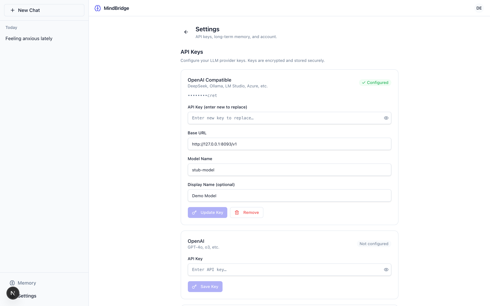
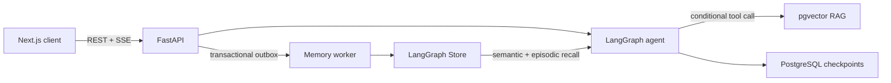

# MindBridge

[](https://github.com/Ex-presso/MindBridge-Agent/actions/workflows/ci.yml)

A mental-health support chat application with a Next.js frontend and a
FastAPI/LangGraph backend, backed by PostgreSQL. Users can resume conversations,
enable memory across sessions, and inspect or clear what the application remembers.

## Screenshots

Screenshots show fictional, seeded demo data; chat replies come from a local model stub.



| Memory controls | Model settings |
|---|---|
|  |  |

## Features

- **Resumable conversations:** PostgreSQL checkpoints, context compaction for
  longer chats, and streamed replies.
- **Conditional retrieval:** the agent can retrieve counselor-style examples
  for support requests instead of adding retrieval to every turn.
- **User-controlled memory:** explicit facts and relevant past episodes can
  carry across conversations. Memory is off by default; saved items remain
  inspectable and deletable when it is disabled.
- **Background extraction:** durable jobs, retries, and consent checks keep
  memory-extraction calls off the conversation request path.
- **Compatible providers:** users bring their own API keys for OpenAI- or
  Anthropic-compatible endpoints. Keys are encrypted at rest.

## Architecture



The model chooses whether to retrieve examples. Application code controls
crisis routing, memory eligibility, and persistence. See the
[architecture and design trade-offs](docs/ARCHITECTURE.md) for the detailed paths.

## Quick Start

Requirements: Docker Compose and an LLM API or local compatible server.

```bash
cp backend/.env.example backend/.env
docker compose up -d
```

Open [localhost:3000](http://localhost:3000), create an account, and configure
a provider under **Settings → Model**. The default is DeepSeek through
`openai_compatible`; for LM Studio, use
`http://host.docker.internal:1234/v1` as the base URL.

Build the retrieval index once before using RAG:

```bash
docker compose exec backend /app/.venv/bin/python -m app.core.rag.knowledge_base
```

This downloads MentalChat16K and Qwen3-Embedding-0.6B (about 1.2 GB for the
model on first use), embeds each client question, and stores it in pgvector
together with the counselor's full answer.

For cross-session memory, set `MEMORY_ENABLED=true` in `backend/.env`,
recreate the backend with `docker compose up -d backend`, and enable memory
in the user's settings. API docs: [localhost:8080/docs](http://localhost:8080/docs).

## Evaluation

Archived results from 2026-08-15, using `deepseek-v4-flash`:

| Check | Scope | Result |
|---|---|---|
| Retrieval tool selection | 45 scored cases; 5 ambiguous cases recorded separately | 45/45 matched expected decisions |
| Safety response markers | 20 probes with required and forbidden phrases | 20/20 passed |
| Cross-session memory | 12 on/off cases, 4 semantic cases, 8 behavior checks | 24/24 passed |

These are small, application-specific regression checks. They do not establish
general answer quality or clinical effectiveness. Datasets, scoring methods,
reproduction commands, and limitations are in [Evaluation](docs/EVALUATION.md).

CI runs backend tests, frontend lint/build, and a Playwright smoke test with
a local model stub. Live model evaluations run separately.

## Documentation

- [Architecture, memory, and limitations](docs/ARCHITECTURE.md)
- [Evaluation methods and results](docs/EVALUATION.md)

## License

[MIT](LICENSE)
