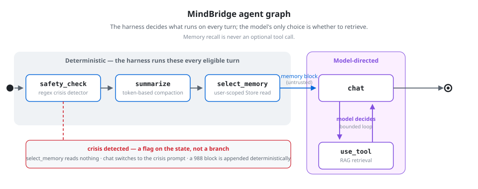
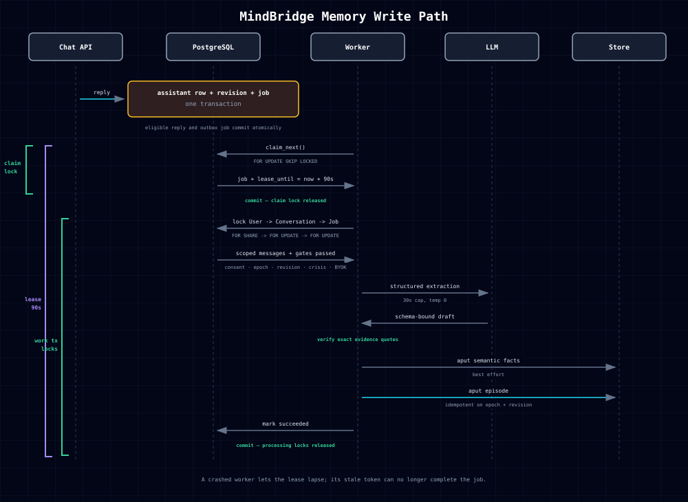

# Agent and memory workflows

MindBridge separates model decisions from application-owned checks. The
overview is in the [README](../README.md); these diagrams show the two main
execution paths.

## Agent workflow

[Interactive diagram](img/skill/agent-graph.html).

The graph runs safety checks, context-budget checks, and eligible memory
selection before chat. The model chooses whether to request the retrieval
tool. A detected crisis uses a separate response path without RAG.

The application decides when these steps run. That does not make all their
work deterministic: compaction can call a summarization model, and chat
generates a model response. Selected durable memory is prompt-local rather
than added directly to checkpointed graph state.

The routing benchmark measures the decision to call the retrieval tool.
It does not measure retrieval relevance or response quality. See
[Evaluation](EVALUATION.md) for its scope and results.

## Memory write path

[Interactive diagram](img/skill/memory-write.html).

For an eligible turn, the assistant reply and extraction job commit in the
same database transaction. The job contains references and version snapshots;
the worker reloads the source messages when processing it.

The worker claims a job using `FOR UPDATE SKIP LOCKED`, commits the claim,
then takes locks in `User → Conversation → Job` order. It rechecks consent,
the data epoch, conversation revision, and lease ownership before extraction
and validates the resulting claims before storage. Revision checks make
retries idempotent; the lease token prevents stale completion updates after
another worker has reclaimed the job.

Processing holds database locks across the extraction call. This coordinates
consent changes and deletion, but can make other operations wait. The worker
currently runs as a task inside the backend process.

Full rules and trade-offs are in [Memory](MEMORY.md), with the lease and
locking tests explained in the [concurrency notes](concurrency_notes.en.md).
