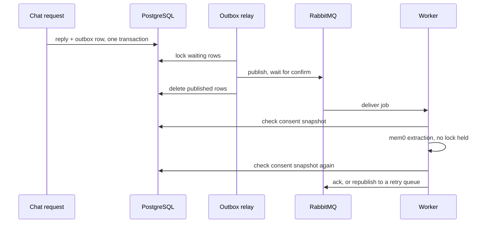

# Architecture

MindBridge uses a Next.js client, a FastAPI API, and a LangGraph agent.
PostgreSQL stores application data, graph checkpoints, and user-scoped memory.
RabbitMQ carries background memory jobs, and Redis holds rate limit counters
and job idempotency keys.
The overview diagram is in the [README](../README.md#architecture).

## Agent workflow

[Interactive diagram](img/skill/agent-graph.html).

The API authenticates the user and loads the conversation. The graph checks
for crisis phrases, manages the context budget, and selects eligible memory
before normal chat. The model chooses whether to call the retrieval tool for
counselor-style examples. Matched crisis requests take a separate response
path with support resources and bypass retrieval.

The knowledge base holds MentalChat16K question/answer pairs. Only the client
question is embedded, because the query the model writes describes a concern
the way a client would; the counselor's answer is returned whole. Matches
below a similarity floor are dropped, and a search refuses to run against an
index that is missing, incomplete, or built with another embedding model.

For longer conversations, compaction first replaces older tool results with
placeholders, then summarizes older turns if needed. Recent messages remain
verbatim. Recalled memory is added to the current model prompt rather than
copied into checkpointed graph state. A model reply may repeat recalled
details, and that reply becomes part of the saved conversation.

## Conversation state and memory

| Storage | Purpose |
|---|---|
| LangGraph checkpoints | Resume the graph state of one conversation |
| mem0 memories in pgvector | Carry facts the user stated into later conversations |

Memory is off by default, both globally and per user.
[mem0](https://github.com/mem0ai/mem0) extracts facts from each user message
with the user's own model, embeds them, and stores them in pgvector. Recall
combines vector similarity with keyword match and keeps results above a
similarity floor. The application adds four things around it:

- **Consent and epochs.** Every memory is stamped with a data epoch.
  Clearing memory disables consent and advances the epoch, so older memories
  can no longer be recalled even before they are deleted, and a job that was
  already running cannot bring them back.
- **Deletion.** Inspection and deletion work while memory is disabled.
  Deleting a conversation, an account, or a single memory removes the
  matching rows. A conversation that reaches a crisis turn is excluded from
  recall at once and its memories are deleted.
- **A veto.** mem0 writes memories with a model, so a deterministic filter
  drops any that state a diagnosis or contain an instruction, when they are
  written and again when they are recalled.
- **Nothing outside PostgreSQL.** mem0's SQLite side store, which holds
  recent raw messages and the text of deleted memories, is replaced with one
  that records nothing, and its telemetry is off.

Only user messages are sent for extraction. Recalled memories are added to
the current prompt rather than copied into checkpointed graph state. A model
reply may repeat a recalled detail, and that reply becomes part of the saved
conversation.

## Background memory jobs

The reply and the job commit in one transaction as an outbox row. The
database and the broker share no transaction, so publishing from the request
could lose a job or announce a turn that was rolled back. A relay publishes
waiting rows to RabbitMQ and deletes each one after the broker confirms it.

Delivery is therefore at least once, and the worker tolerates duplicates in
two ways. A Redis key per job id absorbs repeats in one round trip, and
before extracting the worker looks for memories already stored for the job's
source message, which still holds if Redis is unavailable.

A failed job is republished to a retry queue whose messages expire back into
the work queue after 5 or 30 seconds. An extraction that fails three times
moves to a dead-letter queue; a deletion is retried without limit. While
RabbitMQ is down, chat keeps working and rows wait in the outbox.

No database lock is held during extraction. The worker checks the job's
consent version and data epoch before the model call and again after it, and
deletes what it wrote if they changed in between.

## Observability

| Signal | Where | Use |
|---|---|---|
| Request id | `X-Request-ID` response header and every log line | Join the log lines of one request |
| Metrics | `GET /metrics`, Prometheus format | Latency by route, time to first token, token usage, model call latency, retrieval outcomes, memory job outcomes and lag |
| Traces | OTLP/HTTP export when `OTEL_EXPORTER_OTLP_ENDPOINT` is set | One trace per request, with a span for each model call, each retrieval, and the memory job the request queued |

Logs, metric labels, and span attributes carry identifiers, counts, and
scores, never message text. Metric labels take values from fixed sets such
as route templates and provider names; model names appear only on spans.
`docker compose --profile observability up -d` starts Jaeger and Prometheus.

## Current limitations

- Crisis detection and the memory veto use English patterns. They can miss
  indirect phrasing and do not establish clinical safety.
- mem0 only adds memories. Contradiction resolution and consolidation of
  stale facts are not implemented.
- Memory depends on the embedding model. If it cannot load, chat continues
  without recall and the memory endpoints return 503.
- The dead-letter queue has no automatic replay; a person has to inspect it.
- Graph checkpoints and relational messages commit through separate clients.
  A failure between those commits can leave graph history ahead of the UI.
- Credential barriers protect outbound calls, but an idle decrypted agent
  object on another replica can remain cached until eviction. Immediate
  invalidation across replicas would need a shared channel or credential epoch.
